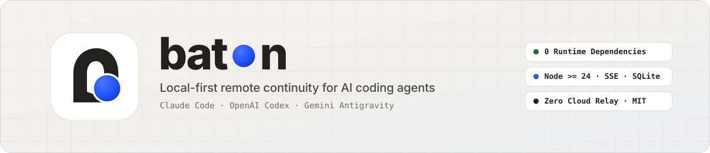
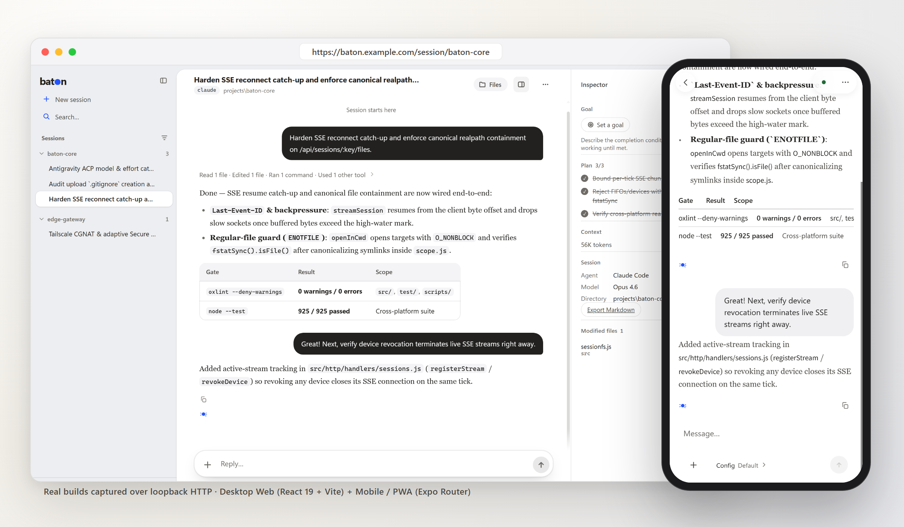
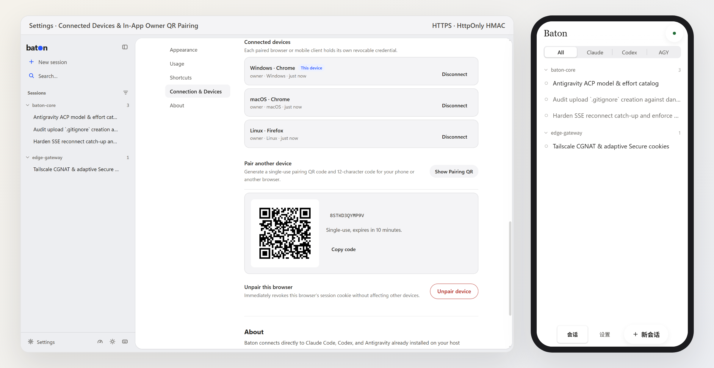
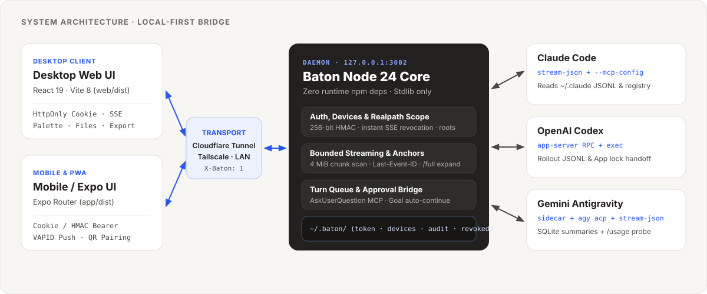

<div align="center">

<picture>
  <source media="(prefers-color-scheme: dark)" srcset="docs/assets/banner-dark.svg">
  <source media="(prefers-color-scheme: light)" srcset="docs/assets/banner-light.svg">
  
</picture>

<br />
<br />

[](https://github.com/YIOYIOIOI/baton/actions/workflows/server.yml)
[](https://github.com/YIOYIOIOI/baton/actions/workflows/web.yml)
[](https://github.com/YIOYIOIOI/baton/actions/workflows/app.yml)
[](https://github.com/YIOYIOIOI/baton/releases/latest)


[](LICENSE)

<p>
  <a href="#quick-start">Quick Start</a> ·
  <a href="#why-baton">Why Baton</a> ·
  <a href="#pairing--device-governance">Pairing &amp; Devices</a> ·
  <a href="#architecture">Architecture</a> ·
  <a href="#supported-agents">Supported Agents</a> ·
  <a href="#documentation">Docs</a> ·
  <a href="docs/README.zh-CN.md">简体中文</a>
</p>

</div>

---

<p align="center">
  
</p>

**Baton** turns your development workstation into a private remote workspace for **Claude Code**, **OpenAI Codex**, and **Gemini Antigravity**. It supports API relays and runs without a cloud relay or a separate database server. Baton stores its state locally in JSON and SQLite files.

It reads real session transcripts directly from disk, streams live turns over Server-Sent Events (SSE), bridges interactive approvals and `AskUserQuestion` prompts, and serves a tailored **Desktop Web UI** (`web/`) and **Mobile / PWA UI** (`app/`) from a single lightweight Node.js `>= 24` process.

---

## Why Baton?

| Pillar | What It Means in Practice |
|---|---|
| **True Disk-Level Continuity** | Reads canonical sessions directly from `~/.claude`, `~/.codex`, and Gemini Antigravity local state. Start work at your desk, continue from your phone, and pick right back up in your desktop CLI or IDE without duplicate databases or sync lock-in. |
| **Zero Cloud, Zero External Deps** | The daemon runs purely on built-in Node.js 24 modules (`node:http`, `node:crypto`, `node:sqlite`). No Redis, no Postgres, no third-party relay server holds your prompts or credentials. |
| **Multi-Principal Realpath Isolation** | Issue single-use 12-character CSPRNG pairing codes pinned to scoped `roots` directories and `--read-only` / `allowSend` ceilings, backed by lexical symlink validation and instant per-device SSE revocation. |

---

## Quick Start

> **Prerequisites**: **Node.js `>= 24.0.0`** and at least one authenticated agent CLI (`claude`, `codex`, or `agy`).

### Option A — Instant Install (Prebuilt UIs Included)

The GitHub Release tarball already ships compiled `web/dist/` and `app/dist/` bundles — no build step required:

```bash
npm install -g https://github.com/YIOYIOIOI/baton/releases/download/v0.2.0/baton-0.2.0.tgz
baton start
```

### Option B — Build from Source

```bash
git clone https://github.com/YIOYIOIOI/baton.git
cd baton
npm run setup
npm start
```

### First-Time Verification & Pairing

```bash
# Inspect Node, agent CLIs, built UIs, and LAN/Tailscale addresses
baton doctor

# Expose temporarily over HTTPS without opening router ports (requires cloudflared)
baton start --tunnel

# Or mint a 12-char pairing code & SVG QR while the daemon is running
baton pair [--for <principal-id>]
```

---

## Pairing & Device Governance

<p align="center">
  
</p>

- **Per-Device Credentials & Instant Cutoff**: Every paired browser holds an `HttpOnly` HMAC cookie tied to a unique `deviceId` (native/mobile callers may request Bearer credentials). Revoking any device from **Settings -> Connection & Devices** immediately closes its active SSE streams.
- **In-App Owner QR Pairing**: Owners can mint fresh single-use 12-character codes and SVG QR codes directly inside Settings — no need to SSH back into the workstation.
- **Markdown Session Export**: Download clean `.md` conversation transcripts with collapsed tool metadata and timestamps from Desktop Web (`InfoPanel`, `ConvHead`, `Ctrl+K` Palette) or Mobile (`SessionMenu`).
- **Adaptive Networking & Web Push**: Works seamlessly over `localhost`, LAN, **Tailscale** (`100.64.0.0/10` with adaptive `Secure` cookies), and **Cloudflare Quick / Named Tunnels**, plus optional VAPID Web Push completion alerts.

---

## Architecture

<p align="center">
  <picture>
    <source media="(prefers-color-scheme: dark)" srcset="docs/assets/architecture-dark.svg">
    <source media="(prefers-color-scheme: light)" srcset="docs/assets/architecture-light.svg">
    
  </picture>
</p>

- **Bounded Streaming Engine**: Scans large transcripts via 64 KB–256 KB windows and 4 MiB byte-offset chunks; truncates oversized tool outputs on the wire while letting clients expand exact slices (`/api/sessions/:key/events/:id/full`).
- **Whole-Tree Process Reaping**: Spawns agent CLIs via strict `argv` allowlists + UTF-8 `stdin` and terminates entire process trees cleanly on Stop or timeout (`taskkill /t` on Windows, negative-PID process group termination on POSIX with non-positive PID guards).
- **Deep Dive**: Read [`docs/architecture.md`](docs/architecture.md) and [`docs/api.md`](docs/api.md).

---

## Supported Agents

| Capability | Claude Code | OpenAI Codex | Gemini Antigravity |
|---|---|---|---|
| **Session Discovery** | Desktop registry + JSONL | `session_index` + rollout JSONL | `conversation_summaries.db` + bridge |
| **Execution & Streaming** | `stream-json` tail | App-server JSON-RPC + `exec` | 3-channel hybrid (`baton-bridge` / `agy acp` / `stream-json`) |
| **Questions & Approvals** | `AskUserQuestion` MCP bridge | RPC approval bridge | Bridge prompt forwarding |
| **Busy Lock Handoff** | Per-session queue | Queues into the live Codex App when it holds the lock and the turn uses default permissions, model, and effort | Tracks desktop turns until completion |
| **Models & Effort Controls** | Dynamic catalog + effort | Model catalog + effort | ACP catalog + 5-tier effort (`low`–`max`) |
| **Live Usage Telemetry** | Yes (owner-only) | Yes (owner-only) | Yes (`agy --print=/usage`, owner-only) |
| **Scoped Files & Uploads** | Contained to session `cwd` | Contained to session `cwd` | Contained to session `cwd` |

---

## CLI Reference

| Command | Purpose |
|---|---|
| `baton [start] [--port N] [--host ADDR] [--tunnel] [--read-only]` | Start the daemon on `127.0.0.1:3002` (or custom bind / read-only mode) |
| `baton pair [--for ID] [--port N] [--host ADDR]` | Mint a single-use 12-char pairing code & `0600` SVG QR |
| `baton doctor [--json]` | Diagnose Node, SQLite, CLIs, credentials, built UIs, and network IPs |
| `baton tunnel [--port N]` | Launch standalone Cloudflare Quick Tunnel (`trycloudflare.com`) |
| `npm run autostart [-- --dry-run \| --uninstall]` | Install OS background startup (`launchd` / `systemd` / Windows Startup) |

Full CLI & configuration reference: [`docs/cli.md`](docs/cli.md).

---

## Repository Layout

```text
baton/
├── src/         Zero-dependency Node.js >= 24 daemon, adapters, HTTP/SSE router, CLI
├── web/         Desktop Web UI (React 19, TypeScript, Vite 8)
├── app/         Mobile & PWA UI (Expo Router, React Native, Zustand)
├── sidecars/    Antigravity companion bridge plugin
├── scripts/     Autostart installer, pairing helper, release & hygiene checks
├── docs/        Engineering guides, visual assets, and protocol specs
├── test/        Cross-platform Node test suite (`node --test --import ./test/setup.js`)
└── .github/     CI/Release workflows, Dependabot, Security, Contributing, Support
```

---

## Documentation

| Guide | Topics Covered |
|---|---|
| [Documentation Index](docs/README.md) | Complete index of guides, references, and protocol notes |
| [Installation & Operations](docs/installation.md) | Tarball vs source build, Tailscale, Cloudflare Tunnels, autostart, guest principals |
| [Architecture Overview](docs/architecture.md) | Bounded JSONL streaming, SSE resumption, process reaping, security boundaries |
| [CLI & Configuration](docs/cli.md) | Subcommands, flags, `~/.baton/config.json`, `principals.json`, env vars |
| [HTTP & SSE Wire API](docs/api.md) | Auth endpoints, session routes, SSE stream framing, `{ error: { code, message, fix } }` |
| [Cloudflare Tunnel Guide](docs/setup/cloudflare-tunnel.md) | Zero-open-port persistent HTTPS remote access setup |
| [简体中文文档](docs/README.zh-CN.md) | Complete Chinese overview and quick start |

---

## Security, Privacy & License

- **Security Policy**: Never commit `~/.baton/` or report security issues publicly. Use **GitHub Private Vulnerability Reporting** (`Security -> Advisories -> Report a vulnerability`) per [`.github/SECURITY.md`](.github/SECURITY.md).
- **Privacy Guarantee**: Zero analytics, zero crash reporting, zero phone-home telemetry, and opt-in external Markdown image links. See [`docs/privacy.md`](docs/privacy.md).
- **Community & Support**: Questions and setup help belong in [GitHub Discussions](https://github.com/YIOYIOIOI/baton/discussions); see [`.github/SUPPORT.md`](.github/SUPPORT.md) and [`.github/CONTRIBUTING.md`](.github/CONTRIBUTING.md).
- **Changelog & Notices**: [CHANGELOG.md](CHANGELOG.md) · [`docs/third-party-notices.md`](docs/third-party-notices.md).
- **License**: Released under the [MIT License](LICENSE).

> *Baton is an independent open-source project and is not affiliated with, endorsed by, or officially connected to Anthropic, OpenAI, or Google.*
