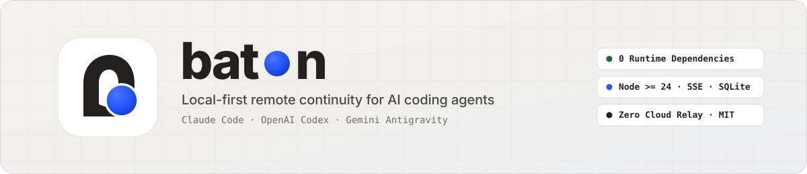
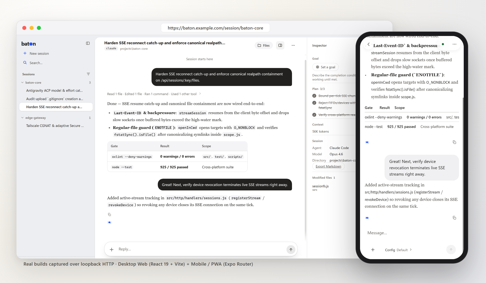
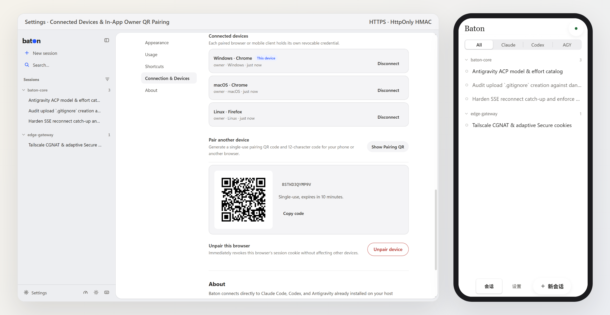
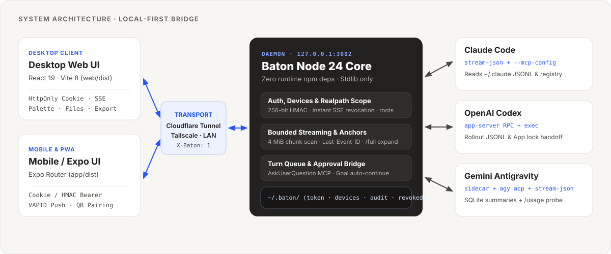

<div align="center">

<picture>
  <source media="(prefers-color-scheme: dark)" srcset="assets/banner-dark.svg">
  <source media="(prefers-color-scheme: light)" srcset="assets/banner-light.svg">
  
</picture>

<br />
<br />

[](https://github.com/YIOYIOIOI/baton/actions/workflows/server.yml)
[](https://github.com/YIOYIOIOI/baton/actions/workflows/web.yml)
[](https://github.com/YIOYIOIOI/baton/actions/workflows/app.yml)
[](https://github.com/YIOYIOIOI/baton/releases/latest)


[](../LICENSE)

<p>
  <a href="#快速开始">快速开始</a> ·
  <a href="#为什么选择-baton">核心设计</a> ·
  <a href="#设备配对与治理">配对与设备治理</a> ·
  <a href="#系统架构">系统架构</a> ·
  <a href="#agent-能力矩阵">Agent 支持</a> ·
  <a href="#文档导航">文档导航</a> ·
  <a href="../README.md">English</a>
</p>

</div>

---

<p align="center">
  
</p>

**Baton** 将你的开发工作站变为可随时随地接入的私有远程编程工作区——无缝衔接本地 **Claude Code**、**OpenAI Codex** 与 **Gemini Antigravity** 会话，**零云端中继、零外部数据库、服务端零第三方运行时依赖，天然适配 API 中转环境**。

---

## 为什么选择 Baton

| 核心支柱 | 工程实现与价值 |
|---|---|
| **真实本地磁盘续接** | 直接读取 `~/.claude`、`~/.codex` 与 Gemini Antigravity 本地状态——桌面端打开的会话可在手机上无缝继续，手机发起的新会话也会直接写回电脑端会话目录，无需同步库。 |
| **零云端与零第三方运行时依赖** | 守护进程仅依赖 Node.js 24 原生标准库（`node:http`、`node:crypto`、内置 `node:sqlite`），无外部数据库、无云端账号锁死、不经过第三方中继服务器。 |
| **多身份真实路径硬隔离** | Owner 可为协作者签发限定 `roots` 目录与 `--read-only` / `allowSend` 上限的专属一次性配对码，结合词法级符号链接拦截与单设备即刻 SSE 吊销。 |

---

## 快速开始

> **前置要求**：**Node.js `>= 24.0.0`**，并已在本机登录或配置好 `claude`、`codex` 或 `agy` 至少一个 CLI。

### 方式一：直接安装预编译发行包（推荐，2 行命令即可启动）

GitHub Release 归档已内含编译好的 `web/dist/` 与 `app/dist/` 界面产物，无需再编译前端：

```bash
npm install -g https://github.com/YIOYIOIOI/baton/releases/download/v0.2.0/baton-0.2.0.tgz
baton start
```

### 方式二：从源码一键构建

```bash
git clone https://github.com/YIOYIOIOI/baton.git
cd baton
npm run setup
npm start
```

### 环境体检、临时隧道与配对

```bash
# 体检 Node、SQLite、Agent CLI、前端产物与网卡 / Tailscale IP
baton doctor

# 通过 Cloudflare Quick Tunnel 一键生成公网 HTTPS 临时访问入口（需安装 cloudflared）
baton start --tunnel

# 在守护进程运行期间签发 12 位一次性配对码与 SVG 二维码
baton pair [--for <principal-id>]
```

---

## 设备配对与治理

<p align="center">
  
</p>

- **每台设备独立可吊销凭据**：浏览器配对后下发绑定 `deviceId` 的 `HttpOnly` HMAC Cookie（原生客户端按需索取 Bearer 凭据）；在「设置 → 连接与设备」吊销任一设备，即刻切断其活跃 SSE 推送流。
- **页面内生成 Owner 二维码**：Owner 可直接在网页端「设置」里生成 10 分钟有效的一次性 12 位配对码与 SVG 二维码，无需再回电脑开终端。
- **一键导出 Markdown 与双语 UI**：支持一键导出含工具调用记录的 `.md` 会话归档，桌面与手机界面支持 `Auto / EN / 中文` 切换且永不翻译 Agent 原始代码、输出与路径。
- **自适应网络与 Web Push 通知**：支持回环地址、局域网、**Tailscale**（自动识别 `100.64.0.0/10` 动态切换 `Secure` Cookie）、**Cloudflare Quick / Named Tunnel**，以及可选的 VAPID 轮次完成推送提醒。

---

## 系统架构

<p align="center">
  <picture>
    <source media="(prefers-color-scheme: dark)" srcset="assets/architecture-dark.svg">
    <source media="(prefers-color-scheme: light)" srcset="assets/architecture-light.svg">
    
  </picture>
</p>

- **有界流式引擎**：以 `64 KB`–`256 KB` 首尾窗口与 `4 MiB` 分块偏移扫描大型 transcript；超长工具输出在线路层边界截断，同时携带字节锚点供按需展开全文（`/api/sessions/:key/events/:id/full`）。
- **整棵进程树安全回收**：严格按参数白名单 + UTF-8 `stdin` 启动 Agent CLI，停止或超时时连带回收整棵子进程树（Windows 使用 `taskkill /t`，POSIX 对正数 PID 使用 `-pid` 进程组信号并守卫非正 PID）。
- 深入设计见 [系统架构文档](architecture.md) 与 [HTTP / SSE 协议文档](api.md)。

---

## Agent 能力矩阵

| 能力维度 | Claude Code | OpenAI Codex | Gemini Antigravity |
|---|---|---|---|
| **会话发现与归组** | 桌面端注册表 + JSONL | `session_index` + rollout JSONL | `conversation_summaries.db` + 桥接 |
| **轮次执行与实时流** | `stream-json` tail | App-server JSON-RPC + `exec` | 三通道混合（`baton-bridge` / `agy acp` / `stream-json`） |
| **交互式问答与审批** | `AskUserQuestion` MCP 桥接 | RPC 审批桥接 | Bridge 交互状态转发 |
| **桌面独占锁移交** | 会话排队 | 撞锁时自动转交 Codex App 队列 | 活跃轮次状态协调 |
| **模型与思考强度调节** | 动态目录 + 强度调节 | 模型目录 + 强度调节 | ACP 权威模型目录 + 五档强度（`low`–`max`） |
| **实时额度遥测** | 支持（Owner 专属） | 支持（Owner 专属） | 支持（经 `agy --print=/usage`，Owner 专属） |
| **工作区文件与附件上传** | 严格限定会话 `cwd` 内 | 严格限定会话 `cwd` 内 | 严格限定会话 `cwd` 内 |

---

## CLI 速查

| 命令 | 说明 |
|---|---|
| `baton [start] [--port N] [--host ADDR] [--tunnel] [--read-only]` | 启动守护进程（默认监听 `127.0.0.1:3002`，支持全站只读限制） |
| `baton pair [--for ID] [--port N] [--host ADDR]` | 生成一次性 12 位配对码与 `0600` SVG 二维码 |
| `baton doctor [--json]` | 检查 Node 版本、SQLite、Agent CLI、前端构建与本机网卡 IP |
| `baton tunnel [--port N]` | 单独启动 Cloudflare Quick Tunnel 指向本地 Baton 端口 |
| `npm run autostart [-- --dry-run \| --uninstall]` | 一键安装跨平台开机自启（`launchd` / `systemd --user` / Windows 启动项） |

完整参数与配置文件（`~/.baton/config.json`、`principals.json`）见 [CLI 与配置参考](cli.md)。

---

## 文档导航

| 文档 | 内容摘要 |
|---|---|
| [文档总索引](README.md) | 全部指南、API 契约与内部协议索引 |
| [安装与运维指南](installation.md) | 发行包安装 vs 源码构建、Tailscale、Cloudflare 隧道、开机自启与多用户配置 |
| [系统架构深度解析](architecture.md) | 有界 JSONL 解析、SSE 断点续推、进程树回收与安全隔离模型 |
| [CLI 与配置参考](cli.md) | 完整子命令参数、`config.json`、`principals.json` 与环境变量 |
| [HTTP / SSE 协议文档](api.md) | REST 路由契约、Cookie / Bearer 认证、SSE 事件与统一错误信封 |
| [Cloudflare 隧道配置教程](setup/cloudflare-tunnel.md) | 免公网 IP / 免开放入站端口接入自有 HTTPS 域名 |
| [English README](../README.md) | 英文主 README |

---

## 安全、隐私与开源协议

- **安全漏洞披露**：请勿公开提 Issue；请通过仓库 **Security -> Advisories -> Report a vulnerability**（GitHub Private Vulnerability Reporting）私密报告，详见 [`.github/SECURITY.md`](../.github/SECURITY.md)。
- **隐私承诺**：零统计埋点、零遥测上报、Markdown 外链图片默认不自动发请求，详见 [隐私声明](privacy.md)。
- **社区支持与贡献**：问题交流请前往 [GitHub Discussions](https://github.com/YIOYIOIOI/baton/discussions)，参与贡献与测试规则见 [`.github/CONTRIBUTING.md`](../.github/CONTRIBUTING.md)。
- **变更记录与致谢**：[CHANGELOG.md](../CHANGELOG.md) · [第三方声明](third-party-notices.md)。
- **开源协议**：基于 [MIT License](../LICENSE) 开源。

> *Baton 为独立开源项目，与 Anthropic、OpenAI 或 Google 无官方关联，亦未获其背书或赞助。*
